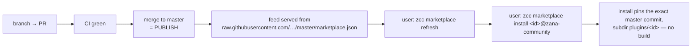
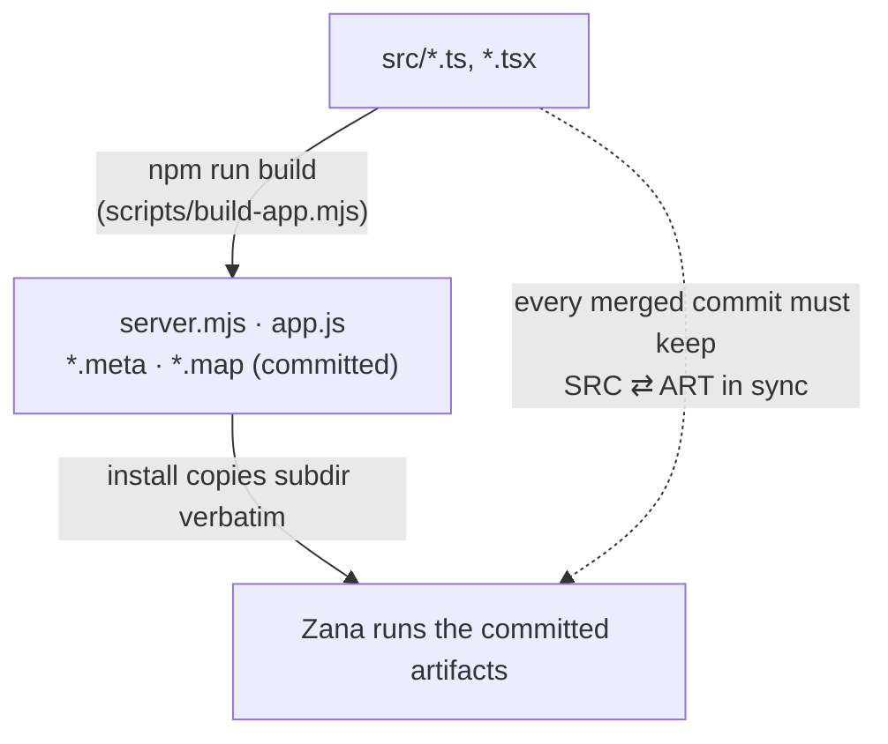
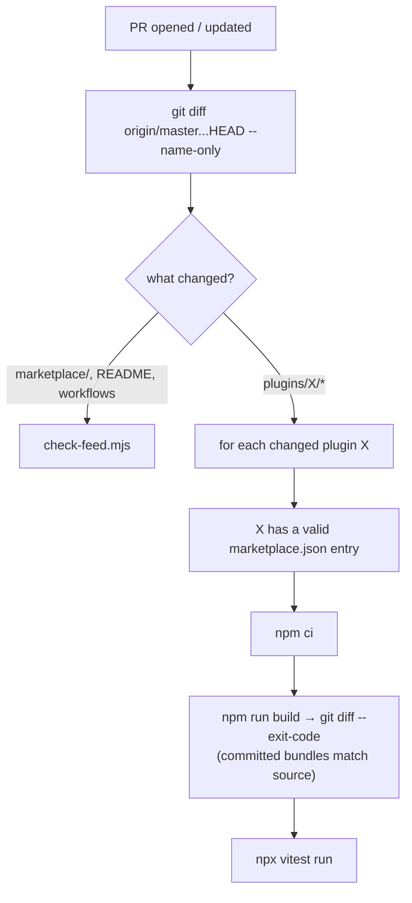

# Engineering workflow

How to develop, publish, and fix plugins in this repository.

**Master is live.** The marketplace feed pins every plugin to

- `url` = this repository,
- `subdir` = `plugins/<id>`,
- `ref` = `master`,

and installation records the **exact commit** of `master` at install time, with **no build step**. So merging a pull request into `master` *is publishing*. Everything else in this document follows from that fact.

## 1. Ground rules

1. **`master` is always live.** Never push directly. Every change arrives by pull request.
2. **One unit of work = one branch = one PR.** Never mix two plugins (or a plugin and infra) in a single PR.
3. **Source and bundles ship together.** Install copies the committed artifacts (`server.mjs`, `app.js`, `*.meta`, `*.map`) verbatim. Every merged commit must have `src/` and the built artifacts in sync — rebuild bundles as the last step of every plugin PR.
4. **Worktrees for parallel work.** One worktree per in-flight plugin; the main checkout stays on `master`.
5. **Feed entry travels with the plugin.** A new plugin adds `plugins/<id>/` **and** its `marketplace/marketplace.json` entry in the same PR, so it goes live atomically.

## 2. Branch taxonomy

| Pattern              | Scope                                  | Lifetime   | Example                     |
| -------------------- | -------------------------------------- | ---------- | --------------------------- |
| `master`             | live feed                              | permanent (protected) | —                           |
| `plugin/<id>`        | brand-new plugin                       | days–weeks | `plugin/notes`              |
| `plugin/<id>/<topic>`| feature on an existing plugin          | days       | `plugin/git-tree/diff-sync` |
| `fix/<id>-<topic>`   | bug fix                                | hours      | `fix/git-tree-build`        |
| `marketplace/<topic>`| feed entries / `check-feed` tooling    | hours      | `marketplace/fix-feed-shape`|
| `infra/<topic>`      | README, CI, `.gitignore`, schemas      | hours      | `infra/ci-plugin-tests`     |

Branches are **short-lived**: merged into `master` then deleted. `master` must stay publishable at every merge; long-running experimental work goes in its own branch and must not block master.

## 3. Branch topology

```mermaid
gitGraph
   commit id: "git-tree v0.1 live"
   commit id: "README: fix install doc"
   branch plugin/git-tree/stash-actions
   commit id: "stash actions + tests"
   checkout master
   commit id: "feed schema tweak"
   checkout plugin/git-tree/stash-actions
   merge master id: "sync master"
   commit id: "rebuild bundles"
   checkout master
   merge plugin/git-tree/stash-actions id: "PR: git-tree v0.2 → LIVE"
   branch plugin/notes
   commit id: "scaffold notes"
```

Rule of thumb: if `master` moved while a branch was open, `git merge master` into the branch before opening (or updating) the PR.

## 4. Parallel work: one worktree per plugin

```
D:\Dev\code\zana-plugins\           ← main checkout · master · docs/feed/infra live here
D:\Dev\wt\zana-plugins_git-tree\    ← worktree · plugin/git-tree/<topic>
D:\Dev\wt\zana-plugins_notes\       ← worktree · plugin/notes
```

- All worktrees share one `.git` object store under the main checkout — one clone, one fetch.
- A branch can be checked out in only one worktree — enforce "one branch = one plugin task".
- Cross-cutting work (README, CI) happens in the main checkout directly off `master`.

```powershell
git worktree add ..\zana-plugins-wt-notes plugin/notes
git worktree list
git worktree remove ..\zana-plugins-wt-notes   # after the PR merges
```

## 5. Playbooks

### 5a. New plugin

```powershell
git switch master && git pull --ff-only
git switch -c plugin/notes
git worktree add ..\zana-plugins-wt-notes plugin/notes   # optional

# scaffold and move into place
zcc plugin new notes --app
Move-Item zcc-plugin-notes plugins\notes
cd plugins\notes
zcc plugin install .
zcc plugin dev                        # zcc plugin ls / zcc plugin logs notes to debug

npx vitest run                        # tests green
npm run build                         # rebuild committed bundles (server.mjs, app.js, *.meta)

# add the "notes" entry to marketplace/marketplace.json (same change-set)
git add -A && git commit -m "notes: initial plugin v0.1"
git push -u origin plugin/notes
gh pr create --fill
# CI green → merge → live
```

### 5b. Feature on an existing plugin

```powershell
git switch master && git pull --ff-only
git switch -c plugin/git-tree/diff-sync
# ...work...
git merge master                      # if master moved, before opening the PR
npx vitest run && npm run build
git add -A && git commit -m "git-tree: diff-sync feature"
git push -u origin plugin/git-tree/diff-sync
gh pr create --fill
```

Bump `version` in `plugins/<id>/package.json` (rebuild so `app.meta.json` / `server.meta.json` pick it up) and append release notes to the plugin's `PLUGIN_OVERVIEW.md` in the same PR.

### 5c. Fix

Same as 5b, with branch `fix/<id>-<topic>` and one tightly scoped change.

### 5d. Cross-cutting (README, CI, feed schema)

```powershell
git switch master && git pull --ff-only
git switch -c infra/<topic>
```

Small, self-contained PR straight to `master`. Never carried inside a plugin branch.

## 6. Publish pipeline

Merging to master publishes immediately — there is no separate release step.



### The bundle-sync rule (main breakage vector)



Always `npm run build` before merging so the committed artifacts match the source.

## 7. Conventions

- **Commit / PR subjects:** prefix with the plugin id — `git-tree: rebuild bundles…`, `marketplace: …`, matching existing history.
- **Versioning:** bump `version` in `package.json` for every published change; the build regenerates the `.meta` files from it.
- **Docs:** keep each plugin's `PLUGIN_OVERVIEW.md` current; add a changelog section per release.
- **No secrets in git**, plugins stay self-contained, and document required CLIs / sign-ins — see README "Rules for contributors".

## 8. CI

Current: `marketplace-feed.yml` runs `check-feed.mjs` on every PR and on pushes to `master`.

Planned extension — per changed plugin:



## 9. Repository settings

- **Branch protection on `master`:** require PR before merging (solo maintainer may merge own PRs), require the `marketplace-feed/check` status, disallow force-push and branch deletion.
- **Auto-delete head branches** after merge.
- Optional release tags: `git-tree/v*`, `notes/v*`.

## 10. Variant: long-lived branch per plugin

An alternative — a single perpetual `plugin/<id>` branch per plugin, publishing via periodic batched PRs to `master`:

| Aspect             | Short-lived per task (this document) | Long-lived per plugin   |
| ------------------ | ------------------------------------ | ----------------------- |
| Publish gate       | every PR                             | batched, when chosen    |
| Drift from master  | none                                 | high — merge master into it often |
| Isolation mechanism| worktree + branch per task           | the branch itself       |
| Recommended when   | default                              | weeks-long unstable experiments in one plugin |

Only switch to the variant if a single plugin starts carrying long-running unstable experiments that should not reach `master` for weeks.
