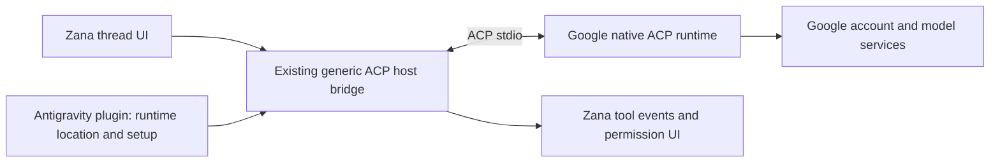

# Native Antigravity ACP investigation and replacement proposal

Date: 2026-10-25. Status: distribution and unauthenticated protocol tested; authenticated execution remains a release gate. No installed provider configuration or runtime source was changed.

## Recommendation

Replace the custom `agy-acp.mjs` CLI translator with Google's native ACP server, using Zana's existing generic ACP bridge. Start with an opt-in native route and make it the default only after authentication, model parity, progress, permissions and restoration checks pass. This is a supported architecture candidate, **not yet a verified drop-in replacement**.

The experiment exposed a concrete prerequisite: native ACP does not create a session until an authentication method is selected, and Zana's current generic bridge does not select Google's advertised methods. A launch-command-only change will fail on this installation.

## What was actually tested

The Windows x86-64 1.4.3 archive was downloaded directly from Google's registry-listed URL into the ignored `tmp/antigravity-native-acp/` directory. Its 131,267,135 bytes matched registry SHA-256:

`54c2e16378d9a4952e1da70e355f3c33c4f284308d6de48ab3e6e34a127bd325`

Extraction contained **both** `agy_acp_server.exe` and `localharness_external.exe`. The runtime must preserve their layout. No installer, PATH change, provider registration or global configuration edit was performed. The package is separate from ordinary `agy` CLI 1.4.7. [Registry distribution](https://cdn.agentclientprotocol.com/registry/v1/latest/registry.json)

A Node stdio probe launched the native server in an empty scratch workspace. It sent protocol v1 initialization with the shipped bridge's honest client identity `{name: "zcc", version: "1.0.0"}` and matching discovery capabilities (filesystem false, terminal false, parameterized model picker true). The initial response arrived approximately **8.55 seconds after process launch**, measured once; this is not a latency benchmark.

| Check | Observed result |
|---|---|
| Launch and NDJSON JSON-RPC | Passed |
| Protocol negotiation | Returned protocol version 1 |
| Agent identity | `antigravity-acp`, version `1.4.3` |
| Authentication methods | `oauth-personal`, `oauth-business`, `gemini-api-key`, `agent-platform` |
| Session loading | Advertised `loadSession: true` |
| Other session capabilities | Advertised `list` and `resume` |
| Input | Advertised image, audio and embedded context |
| MCP | Advertised HTTP and SSE capabilities |
| Extra metadata | Advertised tier information and appendable system prompt |
| `session/new` with empty MCP list | Rejected immediately with `-32000 Authentication required` |
| Error detail | No authentication method selected; call `authenticate` or select `auth.type` in the native settings file |
| Existing native settings | Server reported `~/.gemini/antigravity-acp/settings.json` missing |

These are **advertised capabilities**, not completed functional tests. `session/new` never produced a session, so model catalog, mode/config options, reasoning controls, prompt delivery, tool events, permission behavior, MCP invocation, history and cancellation remain unverified.

The probe intentionally stopped at the authentication boundary. It did not call OAuth, open a browser, copy tokens, switch to API billing or submit a model prompt. The result does not prove the existing CLI login cannot be reused *after selecting* an auth method; it proves selecting the method is required here.

### Process-lifecycle observation

Closing probe stdin and subsequently killing its directly spawned process did not immediately close all inherited output handles. A remaining process running this exact downloaded executable was identified and stopped, after which the probe finished. All identified probe processes were cleaned up. This indicates that Windows cleanup needs a process-tree check; it does not establish which internal process arrangement caused the behavior or prove a general native-server shutdown defect.

The probe script, raw results and stderr are in ignored local scratch storage. The portable evidence needed for this proposal is summarized above; no account data or secrets are included here.

## Replacement architecture

The plugin retains provider registration, branding, runtime discovery, setup/authentication status and release metadata. Zana's ACP bridge owns request lifecycle, standard notifications, permission interactions and thread identity. Google owns native conversations, tools and model execution. The custom text/NDJSON parser, synthetic sessions and per-prompt CLI spawn are removed from the native path.

### 1. Authentication is explicit and provider-aware

The current `resolveAcpAuthMethodId` in `packages/provider-bridge-acp/src/bridge/bridge.ts:691` selects only `xai.api_key` or `cached_token`. Both the local Zana source and the plugin's committed host bundle have this limitation. None of Google's four advertised methods matches.

Proposed host change: add a validated optional authentication-method selection to the ACP launch configuration and verify it against the initialized method list. Keep interactive sign-in separate from background discovery/startup. For this subscription provider, recommend `oauth-personal`; enterprise users can select the documented enterprise path. Do not silently use the currently passed-through `GEMINI_API_KEY` as a subscription substitute.

Setup should report distinct states: runtime missing, runtime launches, sign-in required, authenticated, and session-ready. A user-triggered sign-in action owns the native process until OAuth completes, then reruns the session readiness probe. Ordinary background discovery must surface “sign-in required” instead of opening login repeatedly. Determine how cached authentication behaves after explicit method selection before finalizing reconnection logic. Google's official guide documents the available choices. [Google authentication guide](https://antigravity.google/docs/ide/extensions/zed)

This is a small shared-host capability, not a reason to recreate a full protocol translator inside the plugin. If an already-supported host auth configuration exists in a newer SDK, use it instead of duplicating it.

### 2. Runtime belongs to the execution host

Use an explicit native-runtime path setting resolved on the machine executing the thread. Offer a managed installation from the official versioned archive with checksum verification and complete extraction, plus a custom-path override. Pin a tested version; upgrades are deliberate and retain the previous version for rollback.

Do not commit Google's proprietary binaries into the marketplace package or rely on the author's checkout. Do not copy a desktop absolute path to a remote host. Installation/setup must target each execution host. The provider's `acpLaunchSpec.command` should ultimately point directly to that host's `agy_acp_server` executable; `args` should be registry/platform-specific, not copied from ordinary `agy` flags.

The host artifact still bundles Zana's generic bridge. Keep Node requirements explicit if the surrounding host architecture requires them; native ACP removes the extra Node adapter process, not necessarily all Node usage in Zana.

### 3. Use actual native metadata

After authentication, discover models and reasoning/config options from the native session. Eliminate the hard-coded cross-provider fallback catalog. Treat a model list failure as a readiness failure or visibly stale cached result.

The old open upstream report of client-dependent model filtering makes model parity a decision gate. Probe with `zcc`, exactly as the shipped host does. If Claude or GPT-OSS is absent, report the tradeoff; never spoof another editor. Image/audio, loading and MCP support should be exposed only where both native server and Zana's bridge can support the feature. [Model filtering report](https://github.com/google-antigravity/antigravity-cli/issues/1318)

### 4. Let native ACP carry tools and permission requests

The existing generic bridge already handles tool notifications and `session/request_permission`. Its current policy allows requests automatically in full mode and sends other requests through the host interaction path. That is a useful existing seam, but it still needs an authenticated native round-trip test.

Do not pass CLI permission-bypass flags to native ACP. Keep the native runtime in a mode that emits permission requests, and verify how its discovered modes/config options affect that behavior. The bundled generic bridge does not currently call `session/set_mode`, so any required native mode setting needs an explicit host extension. Do not assume native mode IDs equal the CLI's modes.

Forward session-scoped MCP servers through ACP `session/new`/`session/load`; avoid editing shared CLI MCP configuration. Use a harmless local test server to verify invocation, transport support and cleanup.

### 5. Persist native thread identity and handle legacy threads honestly

Store Google's returned native session ID as the provider thread ID. Test `session/load` across process restart and verify both replayed history and a remembered marker. Do not equate the advertised `resume` capability with the existing host's implemented restoration method.

Existing `agy-*` IDs were invented by the old adapter and have no recorded mapping to native conversations. They cannot be migrated as native IDs. During the transition, record which backend created each thread, keep existing transcripts readable, and offer an explicit “continue in native session” operation with a user-visible context handoff. This is a fresh native conversation, not restoration. Preserve a temporary explicit legacy route if needed until users move; never switch a live thread's transport silently.

### 6. Preserve observability and bounded cleanup

Record request/session correlation, runtime version, launch/initialize/session-ready/first-update/terminal timestamps, error category and exit code. Keep prompts, tokens and unredacted tool payloads out of routine logs. Show starting, authenticating, running, waiting for permission and stalled states where the host UI supports them.

Retain startup and inactivity supervision, cancel acknowledgement handling, and Windows process-tree cleanup. A historical native issue reported missing terminal responses even after output, so native migration is not a reason to infer completion from prose or automatically resend prompts. [Historical completion issue](https://github.com/google-antigravity/antigravity-cli/issues/1041)

## Proposed implementation sequence

| Phase | Deliverable | Exit condition |
|---|---|---|
| A — Authenticated compatibility experiment | Explicit Google authentication, actual catalog and captured bounded protocol traces | A session works under honest `zcc` identity; required models are available or tradeoff is accepted |
| B — Native registration behind opt-in setting | Direct native launch, host-aware runtime discovery, truthful doctor, shared auth support | A new Zana thread completes one prompt with visible events and useful errors |
| C — Behavioral qualification | Progress, permissions, MCP, continuity, restart, cancellation and cleanup tests | Acceptance matrix below passes through the actual host/UI |
| D — Default switch and migration | Backend-tagged threads, explicit legacy handoff, pinned native default, release notes | New threads use native; old transcripts remain accessible; rollback is documented |
| E — Remove legacy adapter | Delete old parser/process/session code and obsolete settings/tests | Migration window closes with no required legacy-only capability |

File scope: `server.ts` registration/settings/doctor; `host.ts` simplified generic bridge wiring; `app.tsx` native setup states; build/dependency fixes; native lifecycle/integration tests; overview and version metadata; regenerated committed bundles. Shared Zana ACP auth/mode/process-supervision changes, if necessary, should be a coordinated separate change rather than hidden plugin-specific hacks.

## Acceptance matrix before default switch

1. **First prompt:** fresh process and new native session complete a harmless fixed prompt repeatedly; warm follow-up also succeeds. Record first-event and terminal times; no resend is required. Use at least five cold runs and five warm turns as a minimum regression sample, not proof that every rare failure is eliminated.
2. **Progress:** a harmless file read produces visible running and completed tool events in Zana, not just raw JSON in the probe.
3. **Permissions:** native emits a request; approve and deny decisions reach it correctly; full mode behavior is explicit; no hidden universal bypass.
4. **MCP:** one session-scoped harmless MCP tool is discovered and called without modifying global config or leaking its config to another thread.
5. **Continuity:** unique marker survives the next turn and process restart; two sessions remain isolated; unknown native IDs fail visibly.
6. **Cancellation/failure:** cancel during a turn, process crash and stalled response produce one terminal host outcome; no work-owning descendants remain; no automatic ambiguous resend.
7. **Catalog/auth:** real account's desired models and effort options work; expired/sign-out states give a usable recovery action rather than fake fallback readiness.
8. **Delivery:** clean installation preserves companion files, verifies checksum, and works without developer paths; remote-host execution is tested if that target is supported.

## Decision

Proceed with the native architecture and an authenticated compatibility experiment. **Do not replace the installed provider yet.** Distribution and protocol compatibility passed, while the local probe established a specific auth integration gap. The remaining gates are concrete and testable; neither model parity nor resolution of the original first-prompt symptom has been established yet.

Further primary-source detail: [native ACP source research](antigravity-native-acp-sources.md). Earlier custom-adapter defects: [code review](antigravity-code-review.md).
